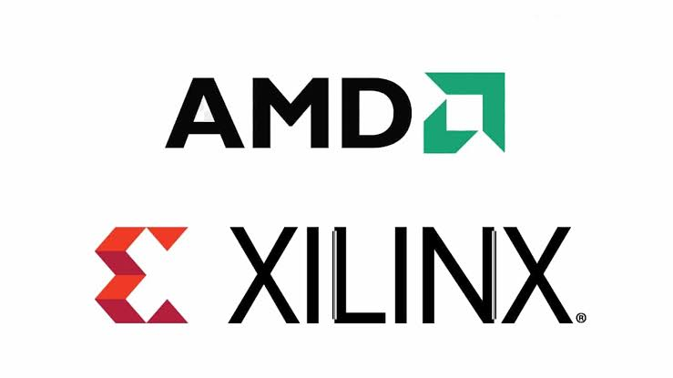
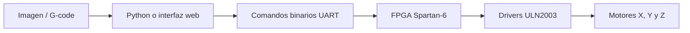

<div align="center">



# Plotter CNC AVANXE

**PLOTTER FPGA - SPARTAN 6**

**FPGA Spartan-6 · VHDL · Python · G-code · Web Serial · Bluetooth**

[**Abrir interfaz web**](https://noctisrh.github.io/plotter-avanxe-bluetoothV2/) · [**Ver código FPGA**](./fpga/) · [**Arquitectura**](./docs/arquitectura.md) · [**Calibración**](./docs/calibracion.md)

</div>

---

## Sobre el proyecto

Poryecto académico de dibujo automatizado que reúne **procesamiento de imágenes**, **comunicación serial** y **control digital de motores a pasos**. Las trayectorias se preparan como G-code y se ejecutan mediante comandos binarios interpretados por una FPGA.

La interfaz web se ejecuta desde el navegador y permite cargar G-code, realizar ajustes de calibración, visualizar y editar trayectorias, y comunicar comandos a través de un puerto serial Bluetooth compatible.

## Galería

<div align="center">
<table>
<tr><td align="center" width="50%">
<br>
<sub>Identidad visual de la interfaz</sub>
</td><td align="center" width="50%">
<strong>Tu plotter, tu trayectoria</strong><br><br>
<sub>Imagen digital → trayectorias → G-code → desplazamientos → dibujo</sub><br><br>
<a href="https://noctisrh.github.io/plotter-avanxe-bluetoothV2/">Abrir la aplicación web</a>
</td></tr>
</table>
</div>

> Las fotografías del mecanismo, las capturas de la aplicación Python y los diagramas de síntesis se pueden incorporar a esta galería cuando se publiquen sus imágenes.

## Las tres partes del sistema

| Parte | ¿Qué hace? |
|:--|:--|
| **Aplicación Python V7.6.1** | Procesa imágenes, extrae y optimiza trayectorias, genera G-code. |
| **Interfaz web** | Importa/edita G-code, muestra la vista previa, calibra y envía instrucciones por Web Serial. |
| **Controlador VHDL** | Recibe comandos UART, valida movimientos, interpola e impulsa los motores por sus drivers. |



## Interfaz web

<div align="center">

</div>

La interfaz incluye **conexión serial**, movimientos de calibración, **vista previa del área de dibujo**, edición básica de trazos y seis figuras de ejemplo almacenadas como archivos G-code externos en `gcode/`.

**Para usarla:** abre la [página web](https://noctisrh.github.io/plotter-avanxe-bluetoothV2/) en un navegador compatible con Web Serial, selecciona el puerto serial disponible, configura los parámetros, carga un G-code y comprueba la vista previa antes de ejecutar.

La conexión Bluetooth clásica requiere que el módulo serial aparezca como puerto accesible en el sistema operativo. La disponibilidad depende del navegador y del dispositivo.

## Controlador de la FPGA

| Archivo | Función |
|:--|:--|
| [C1](./fpga/C1_RECEPCION_UART.vhd) | Recepción serial UART 8N1 |
| [C2](./fpga/C2_INTERPRETE_COMANDOS.vhd) | Interpretación de tramas y comandos |
| [C3](./fpga/C3_CONTROL_MOVIMIENTO_XY.vhd) | Interpolación DDA y temporización de pasos |
| [C4](./fpga/C4_CONTROL_MOTOR_X.vhd) | Secuencia de fases del motor X |
| [C5](./fpga/C5_CONTROL_MOTOR_Y.vhd) | Secuencia de fases del motor Y |
| [C6](./fpga/C6_CONTROL_MOTOR_Z.vhd) | Secuencia de fases del motor Z |
| [C7](./fpga/C7_POSICION_Y_LIMITES.vhd) | Posición comandada y límites |
| [C8](./fpga/C8_TRANSMISION_UART.vhd) | Transmisión de respuestas UART |
| [TOP](./fpga/TOP_PLOTTER_CNC.vhd) | Integración de módulos |
| [Restricciones](./fpga/TOP_PLOTTER_CNC_AVANXE.ucf) | Asignación de pines y restricciones |

**Nota sobre la versión de los archivos:** el `TOP_PLOTTER_CNC.vhd` incluido en `fpga/` corresponde al conjunto de fuentes compartido para documentación; **expone UART por cable y señales de seguridad**, pero no expone directamente `bt_rx`, `bt_tx` ni `sel_bluetooth`. Además, el archivo UCF compartido no contiene restricciones para todas las entradas adicionales del TOP (`estop_n` y `limit_*_n`). Por eso **estos archivos son fuentes de referencia y aún requieren revisión de compatibilidad antes de sintetizar o conectar el hardware**, y no se presentan como una compilación verificada de la variante Bluetooth. La web queda intacta y es independiente de estos archivos fuente.

Más detalles en [Arquitectura del sistema](./docs/arquitectura.md).

## Estructura del repositorio

```text
.
├── index.html, estilo.css
├── app.mjs, editor.mjs, protocolo.mjs, pruebas.mjs, nieve.js
├── assets/          Recursos visuales utilizados por la web
├── gcode/           Figuras predeterminadas
├── fpga/            Fuentes VHDL y restricciones UCF
├── docs/            Documentación del funcionamiento
└── README.md        Presentación del proyecto
```

## Calibración y seguridad

El software convierte los destinos expresados en milímetros a pasos comandados mediante una escala de **pasos/mm** configurada para cada eje. El sistema es de **lazo abierto**: el conteo de pasos no comprueba la posición física.

Antes de ejecutar, comprueba la calibración, el origen, los límites y la altura del plumón. **STOP por software no reemplaza una parada de emergencia física.**

[**Guía de calibración**](./docs/calibracion.md)

## Referencias y créditos

- [Briuwu — Automatic-IG-Drawing](https://github.com/Briuwu/automatic-ig-drawing): referencia conceptual del tratamiento de imágenes utilizado en el desarrollo de la aplicación Python.
- [Chrome for Developers — Web Serial](https://developer.chrome.com/docs/capabilities/serial?hl=es-419): documentación de la API Web Serial.

---

<div align="center">

**Plotter CNC AVANXE — Proyecto académico de control digital y dibujo automático**

<sub>Repositorio mantenido por NoctisRH</sub>

</div>
